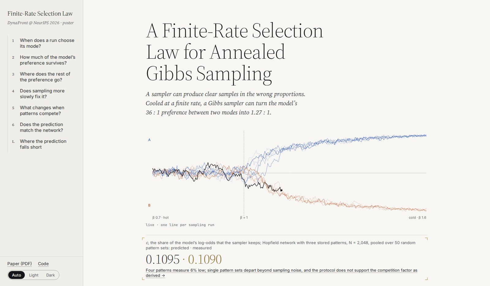

# A Finite-Rate Selection Law for Annealed Gibbs Sampling

[](https://github.com/ali-izhar/finite-rate-selection-law/actions/workflows/checks.yml)
[](https://ali-izhar.github.io/finite-rate-selection-law/)
[](LICENSE)

Izhar Ali, Muhammad Haris Khan, Saeed Ahmad · DynaFront Workshop at NeurIPS 2026 (poster)

[**Paper**](paper/main.pdf) · [**Poster**](poster/poster.pdf) · [**Visual edition**](https://ali-izhar.github.io/finite-rate-selection-law/) · [**Reproduce**](docs/reproduce.md)

<a href="https://ali-izhar.github.io/finite-rate-selection-law/"><picture>
  <source media="(prefers-color-scheme: dark)" srcset="docs/images/visual-edition-dark.jpg">
  
</picture></a>

A sampler can draw realistic samples in the wrong proportions. In annealed Gibbs sampling, the mode
is chosen early in cooling, near a transition, where a weak preference competes with random
fluctuations; afterwards, switching modes is slow (at N = 2048 and β = 1.1, a switch takes about
5×10⁷ sweeps, against at most 3600 on our ramps). The samples then keep only a fraction **c** of the
model's log-odds: with c = 0.2, model odds of 4:1 become 1.32:1. We give a law for c, built on a
classical result for this selection. It explains why slower cooling helps little: on a linear ramp and for a weak field,
sixteen times more sweeps only doubles c (a sweep is N single-variable updates).

## Results

| Test | Predicted | Measured | In the paper |
|---|---|---|---|
| Exact Curie–Weiss chain, 3 sizes × 3 cooling rates | the law | c above the law by 0.23–1.81% | Sec. 3, Table 2 |
| Hopfield, 1 pattern, N = 1024, 2048, 4096 (sampler check) | exact chain: 0.0937, 0.0659, 0.0464 | ratio 0.990, 1.001, 1.015 | Sec. 4, Table 1 |
| Hopfield, 2 patterns, N = 2048 | exact two-block chain: 0.0936 | 0.0946 [0.0928, 0.0965] | Sec. 4, Table 1 |
| Hopfield, 3 patterns, N = 2048 (primary) | A₃ c_CW = 0.1095 | 0.1090 [0.1059, 0.1123] | Sec. 4, Table 1 |
| Hopfield, 3 patterns, N = 1024, 4096 | 0.1558, 0.0772 | 0.1518, 0.0758 | Sec. 4, Table 1 |
| Hopfield, 4 patterns, N = 2048 | A₄ c_CW = 0.1209 | 0.1137 [0.1069, 0.1210] (6% low) | Sec. 5, Table 1 |
| Hopfield, single pattern sets (post hoc) | the same c in every set | c varies beyond sampling noise (standard deviation 7–13% of the prediction) and falls as pattern 1's win share rises | Sec. 5, App. B, Table 4 |

The exact check evolves the N + 1 counts of the Curie–Weiss Gibbs chain, without sampling noise. The
Hopfield test follows a written protocol ([docs/protocol-simple.md](docs/protocol-simple.md)), committed
with the results, so no external record shows that it preceded the runs. Every run cools on one linear
ramp (β = 0.7 to 1.6 at γ = 0.004), and intervals are 95% over the 50 pattern sets. With one pattern
the sampler is exactly the Curie–Weiss chain; two patterns have an exact prediction; for three and four,
the prediction multiplies the Curie–Weiss fraction by a competition factor A_p derived for independent
Gaussian amplitudes. Pooled over all runs, the measured c is within 3% of A_p c_CW for three patterns at
three sizes and 6% below it for four (point estimates). Single pattern sets depart from the prediction
beyond sampling noise (post hoc), so the agreement holds for pooled runs, not one network. By the
protocol's readings, A_p is not supported as derived, because the deficits do not order with p/(Nγ)
(paper Sec. 5, App. B). The results concern Gibbs cooling, not reverse diffusion.

## Quick start

Python 3.12 or 3.13 and a CPU are enough to recheck every number the paper prints:

```bash
python3 -m venv .venv && source .venv/bin/activate
pip install -r requirements-dev.txt
python -m src                          # the exact sampler: "82/82 checks passed" (seconds)
python -m pytest -q src/simple/tests   # the Hopfield-test code; the GPU test is skipped without torch
python -m checks.claims                # every printed number: "150 PASS, 0 FAIL, 2 UNVERIFIED" (about 4 min)
```

The two UNVERIFIED rows are the GPU runs; their saved outputs are checked.
[checks/claims.md](checks/claims.md) lists every number with its location in the paper, and
[docs/reproduce.md](docs/reproduce.md) gives one command for every table and figure, including the GPU runs.

## Layout

| Folder | Content |
|---|---|
| [`paper/`](paper/) | the paper: `main.tex`, `main.pdf`, bibliography, DynaFront template, figures and their script |
| [`src/`](src/) | the exact Curie–Weiss chain and its checks; `cw_ramp.py` (Table 2); [`simple/`](src/simple/) (the Hopfield test); `posthoc.py` (the post-hoc per-set analysis, Table 4) |
| [`results/`](results/README.md) | saved runs, each with the script that wrote it and its place in the paper |
| [`checks/`](checks/README.md) | checks of every number, table and caption in the paper |
| [`docs/`](docs/) | [protocol](docs/protocol.md), [Hopfield-test protocol](docs/protocol-simple.md), [reproduction steps](docs/reproduce.md) |
| [`visual/`](visual/README.md) | the [visual edition](https://ali-izhar.github.io/finite-rate-selection-law/): interactive simulations of the paper; `node visual/tools/serve.mjs` serves it at http://127.0.0.1:8765 |
| [`poster/`](poster/README.md) | the workshop poster (24 × 36 in) and its build |

## Citation

```bibtex
@inproceedings{ali2026finiterate,
  title     = {A Finite-Rate Selection Law for Annealed Gibbs Sampling},
  author    = {Ali, Izhar and Khan, Muhammad Haris and Ahmad, Saeed},
  booktitle = {DynaFront Workshop at NeurIPS 2026},
  year      = {2026},
  url       = {https://github.com/ali-izhar/finite-rate-selection-law}
}
```

## License

Code: [MIT](LICENSE). Paper and figures: [CC BY 4.0](LICENSE-CC-BY-4.0).
Fonts: SIL Open Font License ([visual/fonts/LICENSES.md](visual/fonts/LICENSES.md)).
`paper/jmlr.cls` and `paper/jmlrutils.sty`: LaTeX Project Public License 1.3;
`paper/dynafront2026.cls`: the DynaFront 2026 template, unmodified.
The logos in `poster/assets/logos/` are trademarks of their owners and are used with permission.
