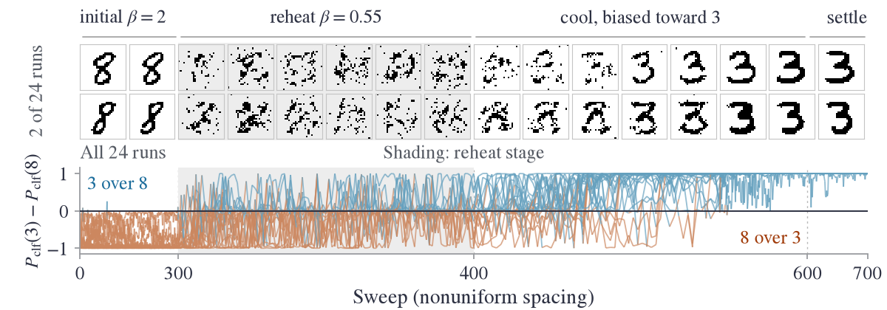

# Reheating in a trained Boltzmann machine (MNIST illustration)

This page shows reheating and reselection in a deep Boltzmann machine trained on MNIST handwritten digits. It
illustrates the protocol of the paper in a learned model. It does not test the selection law.

Two runs chosen for illustration (top) and classifier probability differences for all 24 runs (bottom). The
sweep axis is piecewise linear. Classifier outputs do not measure equilibrium digit probabilities.

## Model

A deep Boltzmann machine (Ackley, Hinton and Sejnowski, 1985; Salakhutdinov and Hinton, 2009) with $0/1$
pixels $v$ and two hidden layers $z_1, z_2$ of 500 binary units each, trained on MNIST (LeCun et al., 1998).
At inverse temperature $\beta$ the distribution is proportional to $e^{-\beta E}$, with

$$E(v,z_1,z_2) = -v^\top W_1 z_1 - z_1^\top W_2 z_2 - b^\top v - d_1^\top z_1 - d_2^\top z_2,$$

where $W_1, W_2$ are learned weights and $b, d_1, d_2$ learned biases.

The stored checkpoint holds the parameters and a 600-epoch history. It does not record the training
algorithm; its file name gives a learning rate of $0.002$.

Each sweep redraws $z_2$ given $z_1$, then $z_1$ given $v$ and $z_2$, then $v$ given $z_1$. A run starts by
drawing $z_1$ given $v$ (with $z_2=0$), then $z_2$.

## Protocol

The figure shows a stored ensemble from an earlier implementation; its update order and image-selection rule
were not recorded. The counts below come from separate runs.

1. Each seed draws 24 distinct training images of digit "8". They run 300 sweeps at $\beta=2$.
2. Reheat: 100 sweeps at $\beta=0.55$.
3. Recool toward "3": add $2(\bar v_3-\bar v)$ to the visible biases $b$ (so $\beta$ also multiplies it) during
   a 200-sweep linear increase of $\beta$ to 2, then 100 settling sweeps. $\bar v_3$ and $\bar v$ are the mean
   pixels of training "3"s and of all training images, thresholded at half intensity.
4. A stored linear classifier labels each endpoint. Its training is not recorded. For pixel vector $v$ it gives
   scores $s_d=w_d^\top v+\alpha_d$ for digits $d=0,\dots,9$, probabilities
   $P_{\mathrm{clf}}(d)=e^{s_d}/\sum_j e^{s_j}$, and the label with the largest score.

## Result and controls

Over ten seeds (NumPy `default_rng` seeds 0-9), reheating and recooling label 20-24 of the 24 endpoints "3".

Two controls ask whether the starting state changes this count:

| Start | Before the biased cooling | Endpoints labeled "3" (of 24, over ten seeds) |
|---|---|---|
| Training "8"s | 300 sweeps at $\beta=2$, reheat 100 sweeps at $\beta=0.55$ | 20-24 |
| Independent random pixels (each on with probability 1/2) | none | 21-24 |
| Independent random pixels | 400 sweeps at $\beta=0.55$ (matches the 700-sweep budget) | 21-24 |

All three rows then receive the same biased 200-sweep cooling and 100 settling sweeps. These small ensembles
resolve only large effects of the initial state.

## Data and code

- `models/boltzmann_machine.npz`: the DBM checkpoint. `models/digit_classifier.npz`: the classifier.
- `src/experiments/dbm_reheat.py` writes `results/experiments/dbm_reheat.npz` (the figure's ensemble).
- `src/experiments/dbm_control_arm.py` writes `results/experiments/dbm_control_arm.json` (the counts above).
- `docs/figures/make_mnist_illustration.py`: rebuilds the figure.
- MNIST: the files `train-images-idx3-ubyte` and `train-labels-idx1-ubyte`, read from
  `~/.cache/mnist_data/MNIST/raw` (set `MNIST_RAW` to override).

## References

- D. H. Ackley, G. E. Hinton, T. J. Sejnowski. A learning algorithm for Boltzmann machines. *Cognitive Science*, 9(1):147-169, 1985.
- R. Salakhutdinov, G. Hinton. Deep Boltzmann machines. *Proceedings of AISTATS*, 448-455, 2009.
- Y. LeCun, L. Bottou, Y. Bengio, P. Haffner. Gradient-based learning applied to document recognition. *Proceedings of the IEEE*, 86(11):2278-2324, 1998.
