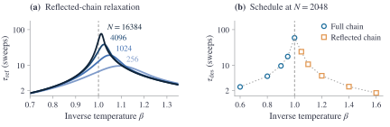

# Relaxation times behind the cooling schedule

> Not used by the current paper. This page describes the earlier protocol and is kept for the visual
> edition; [protocol.md](protocol.md) describes the protocol the paper uses.

The paper's cooling schedule (Table 3) dwells $\lceil 6\tau_{\mathrm{des}}\rceil$ sweeps at each of ten
inverse temperatures. This page shows the relaxation times $\tau_{\mathrm{des}}$ and how they grow with $N$.

**(a)** Zero-field reflected-chain inverse gaps $\tau_{\mathrm{ref}}$, labeled by $N$. **(b)** Schedule-design
time $\tau_{\mathrm{des}}$ at $N=2048$: full chain for $\beta\le1$, reflected chain above. Symbols mark the ten
schedule temperatures; gray connectors guide the eye.

## Definitions

At fixed temperature, the count chain of the paper (Appendix A, Eqs. 8-10) evolves as $\dot P = QP$, where $Q$
is the matrix of transition rates. If $Qv=-\lambda v$ with $\lambda>0$, a deviation in direction $v$ decays as
$e^{-\lambda t}v$. The smallest positive $\lambda$ is the *spectral gap*; its inverse $\tau$ is the time in which
the slowest deviation from equilibrium shrinks by $e^{-1}$.

- **Full chain**: all counts $k=0,\dots,N$. It includes the slow relaxation of the balance between positive
  and negative spins.
- **Reflected chain** (even $N$): keeps $k=N/2,\dots,N$, sets $W^-_{N/2}=0$, and leaves the other rates unchanged.
  It measures relaxation within one sign.

The schedule uses the full chain for $\beta\le1$, because reflection would remove the balance between signs,
and the reflected chain above, where switching between modes takes far longer than the schedule (paper,
Appendix A). The six-$\tau$ dwell is a
relaxation prescription, not a bound on the error in final mode probabilities.

## Numbers

Design times at $N=2048$ (zero field):

| $\beta$ | 0.60 | 0.80 | 0.90 | 0.95 | 1.00 | 1.05 | 1.10 | 1.20 | 1.40 | 1.60 |
|---|---|---|---|---|---|---|---|---|---|---|
| chain | full | full | full | full | full | refl. | refl. | refl. | refl. | refl. |
| $\tau_{\mathrm{des}}$ (sweeps) | 2.50 | 4.97 | 9.68 | 17.69 | 59.00 | 24.15 | 10.73 | 5.12 | 2.54 | 1.69 |
| dwell $\lceil 6\tau_{\mathrm{des}}\rceil$ | 15 | 30 | 59 | 107 | 355 | 145 | 65 | 31 | 16 | 11 |

The dwells sum to 834 sweeps. The value at $\beta=1.6$, $\tau_{\mathrm{ref}}=1.6946$, is also the correlation
correction in the equilibrium-reference standard error (paper, Appendix B).

Peak of $\tau_{\mathrm{ref}}$ over $\beta$:

| $N$ | 256 | 1024 | 4096 | 16384 |
|---|---|---|---|---|
| peak $\tau_{\mathrm{ref}}$ (sweeps) | 9.70 | 19.27 | 38.48 | 76.94 |
| peak $\beta$ | 1.094 | 1.048 | 1.024 | 1.012 |
| peak $/\sqrt N$ | 0.606 | 0.602 | 0.601 | 0.601 |

The peak doubles when $N$ grows fourfold: it grows as $\sqrt N$ (peak$/\sqrt N$ is 0.62 at $N=64$ and 0.601 at
$N=16384$). Redesigning the counts for each $N$ would
make the dwell at $\beta=1$ grow as $\sqrt N$. The paper computes the counts once, at $N=2048$, and reuses them at
every size.

## Data and code

- `visual/data/tracking_time.json`: $\tau_{\mathrm{ref}}(\beta)$ for each $N$ and the bounded peak scan.
- `visual/data/schedule.json`: the ten temperatures, $\tau_{\mathrm{des}}$, and the dwell counts.
- `src/gap.py`: the full-chain and reflected-chain gaps.
- `docs/figures/make_relaxation_times.py`: rebuilds the figure.
