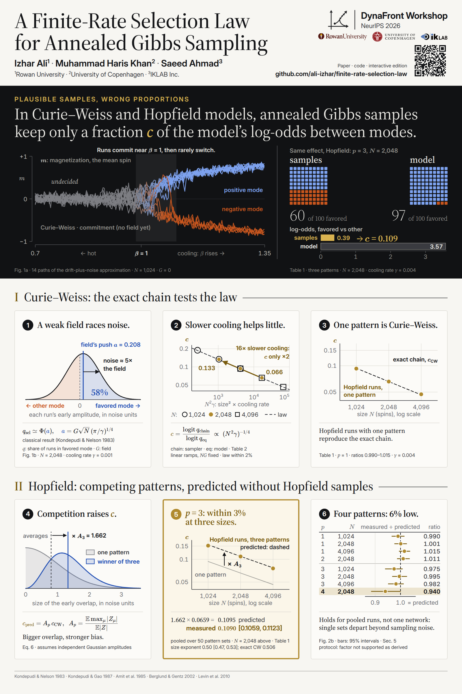

# Poster

The poster for the DynaFront Workshop at NeurIPS 2026: [`poster.pdf`](poster.pdf), 24 × 36 in,
portrait. [`poster.png`](poster.png) is a 1600 × 2400 px preview.



## Layout

1. **Header.** Title, authors, venue, logos, and one QR code to this repository.
2. **Hero.** Annealed Gibbs samples keep only a fraction *c* of the model's log-odds between
   modes: runs commit near *β* = 1 (Fig. 1a paths); with three Hopfield patterns at *N* = 2,048
   the samples favor a pattern 60 times in 100 where the model gives 97 (*c* = 0.109, Table 1).
3. **I. Curie–Weiss.** (1) A weak field races noise: *a* = 0.208, 58%. (2) Sixteen times slower
   cooling only doubles *c*. (3) Hopfield runs with one pattern reproduce the exact chain.
4. **II. Hopfield.** (4) Competition among patterns raises *c* by *A*<sub>3</sub> = 1.662.
   (5) Pooled over all runs, the measured *c* is within 3% of the prediction for three patterns at
   three sizes. (6) For four patterns it is 6% lower; single pattern sets depart from the prediction
   beyond sampling noise, so the agreement holds for pooled runs, not one network, and the protocol
   does not support the factor as derived (Fig. 2b, Sec. 5).

Every printed number comes from [`paper/main.tex`](../paper/main.tex); `make_figures.py` asserts
each one against the paper source and stops the build if one differs.

## Rebuild

```sh
./poster/build.sh
```

1. `make_figures.py` (numpy, scipy) writes the vector figures `figures/V*.svg` from
   `results/simple/`, `results/experiments/cw_linear_sweep.json`,
   `results/figures/fork_trajectories.json` and analytic curves. It uses `.venv/bin/python` if present; set
   `PYTHON=...` to choose another interpreter.
2. `build.mjs` writes the QR code, inlines the figures, renders the math with KaTeX, checks every
   block for overflow, and prints `poster.pdf` and `poster.png` with Playwright's headless Chromium
   (set `CHROME_PATH=...` to use another browser).
3. `check_qr.mjs` decodes the QR code from the preview and compares it with the repository URL.

The first run installs the pinned Node dependencies (`package.json`) into `poster/node_modules` and
Playwright's headless Chromium. Fonts are local (`../visual/fonts/`, linked from `poster.css`, and
`fonts/katex/`), so the render needs no network.

## Files

| File | Purpose |
|---|---|
| `poster.html`, `poster.css` | page source and styles |
| `make_figures.py` | the vector figures, with a check of every number against the paper |
| `build.sh`, `build.mjs`, `check_qr.mjs`, `package*.json` | build and checks |
| `figures/`, `assets/qr-repo.svg` | generated figures and QR code |
| `assets/logos/` | workshop and institution logos; sources and brand rules in `SOURCES.md` |
| `fonts/katex/` | KaTeX stylesheet and fonts |

The logos are trademarks of their owners and are not covered by the repository licenses.
